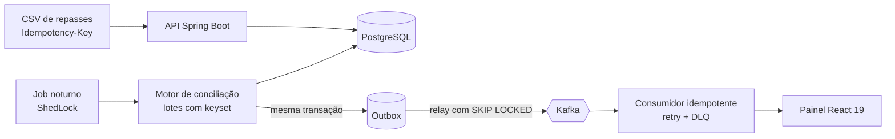

  

  
  
  

## ⏱️ Para recrutadores: o resumo em 30 segundos

| | |
|---|---|
| **Cargo** | Engenheiro de Software Full Stack |
| **Stack principal** | TypeScript · NestJS · Angular · React/Next.js · Go · PHP · Java/Spring Boot |
| **Dados e infra** | PostgreSQL · MySQL · Kafka · AWS (ECS, S3) · Docker · GitHub Actions |
| **Hoje** | Lead técnico do ecossistema de almoxarifado e estoque na **Orion** (antiga Salte Tecnologia) |
| **Também** | Freelancer na **Etech**: plataformas SaaS e produtos com IA (LLM) para clientes |
| **Modelo** | Remoto · CLT ou PJ · híbrido em Taubaté ou São José dos Campos/SP |

## 🔒 O que este perfil não mostra

A maior parte do meu código está em repositórios privados das empresas. Em números:

| Pull requests integrados | Na Orion | Em clientes da Etech | Contribuições no último ano |
|:---:|:---:|:---:|:---:|
| **350+** | **170+** | **179** | **1.500+** |

## 🏗️ Projeto em destaque: [Payment Reconciliation API](https://github.com/SamuelVNO/payment-reconciliation-api)

Concilia os pedidos de uma loja com o que o adquirente (Cielo, Stone, Getnet...) realmente pagou e aponta cada centavo fora do lugar.
**Java 21 · Spring Boot 3 · PostgreSQL 17 · Kafka · Testcontainers · React 19**

**Decisões que eu defendo numa entrevista**

| Problema | Decisão | Prova |
|---|---|---|
| Dinheiro com precisão | `BigDecimal` + `NUMERIC(19,2)`, arredondamento bancário | Teste que mostra por que `equals` falha e `compareTo` não |
| Repasse importado duas vezes | Idempotência em 3 camadas | `Idempotency-Key`, `payout_id` e `UNIQUE NULLS NOT DISTINCT` |
| Consulta lenta com volume | Paginação keyset + índice composto | **29,4 ms → 0,56 ms** com 300 mil pedidos (EXPLAIN ANALYZE) |
| Dual write entre banco e fila | Transactional Outbox | Relay com `FOR UPDATE SKIP LOCKED`, várias instâncias em paralelo |
| Confiança para mudar | 43 testes, 18 com Postgres e Kafka reais | CI no GitHub Actions publicando imagens Docker |

## 💼 O que já entreguei em produção

- **Estoque e almoxarifado (Orion):** módulos de reposição com motor de mínimo/máximo, inspeção e negociação de compras e o ciclo completo de inventário. Redesenhei o motor de custeio atrás de feature flag e corrigi em produção um defeito de ponto flutuante que corrompia saldos de lotes, validando com dados reais antes de ativar.
- **Eventos esportivos (Etech):** plataforma de entrega de kits com API, painel e worker assíncrono na AWS (ECS + S3), importação de inscrições por planilha, numeração em lote e gestão multi-organização.
- **IA aplicada (Etech):** gerador de site de evento com LLM, com briefing conversacional, page builder e preview ao vivo.
- **CASACOR (via Etech):** único desenvolvedor do sistema de credenciamento usado em 5 franquias, incluindo suporte integrado ao WhatsApp.

## 🧰 Stack

## 📂 Outros projetos públicos

- **[integracoes-apis-publicas](https://github.com/SamuelVNO/integracoes-apis-publicas)** — quatro integrações com APIs públicas em Next.js 15, com cache, timeout e tratamento de erro
- **[products-api](https://github.com/SamuelVNO/products-api)** — API REST de produtos com NestJS, PostgreSQL e TypeORM
- **[products-front](https://github.com/SamuelVNO/products-front)** — front-end de e-commerce em Angular 19 integrado ao Supabase

---

🎓 Engenharia de Software na Estácio (em andamento) · 📍 Taubaté, Vale do Paraíba/SP

